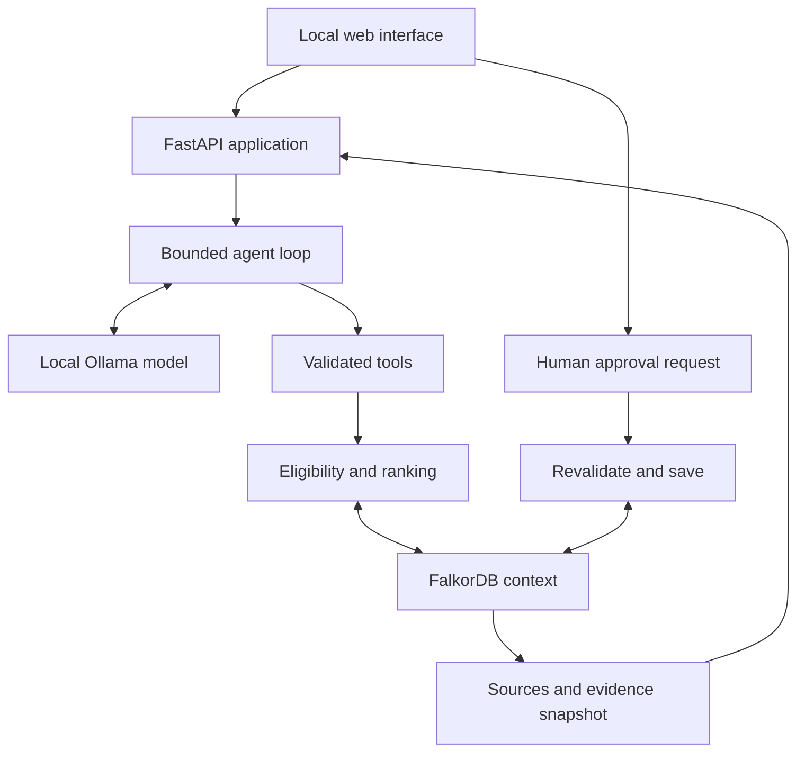

# Architecture

## Components and ownership

| Component | Choice | Responsibility |
| --- | --- | --- |
| Web UI | React, TypeScript, Vite | Campaign picker, chat, candidates, evidence, decisions, synthetic edits |
| API | Python 3.11+ and FastAPI, validated models | Tool execution, business rules, consistency, mutation authorization |
| Context store | FalkorDB, official Python client | Relationships, sources, sessions, runs, decisions, proposals |
| Inference | Ollama on host, local model | Interpret the task, select tools, produce an evidence-bound explanation |
| Fixture inputs | Versioned JSON and local Markdown source text | Reproducible seed inputs; never a runtime answer backend |
| Verification | pytest plus one Playwright browser flow | Rule correctness, real graph integration, usable end-to-end behavior |

Use a supported installed Node version; Node 22.12+ is a suggested starting baseline to check against the selected Vite release. Pin actual tested dependencies in lockfiles. Do not guess exact newest versions.

## Data flow

Only the backend talks to the model and database. A UI graph is rendered from returned graph facts, not invented from model text. Business-rule functions consume graph query results and may do bounded deterministic comparisons, but cannot replace graph traversal with fixture-file lookups.

## Proposed repository layout

| Path | Contents |
| --- | --- |
| `frontend/src/` | Screens, candidate/evidence components, API client, types |
| `backend/app/main.py` | API entry point |
| `backend/app/config.py` | Local-only configuration validation |
| `backend/app/models/` | Request, response, graph DTO models |
| `backend/app/routes/` | Health, campaigns, sessions, runs, proposals, decisions, demo facts |
| `backend/app/services/` | Evaluation, memory, proposal, source, revision services |
| `backend/app/agent/` | Ollama adapter, loop, tool registry, prompts, output validation |
| `backend/app/queries/` | Versioned, named Cypher templates |
| `backend/app/db/` | Client adapter, serializers, lock/CAS helper, seeding |
| `backend/tests/` | Rule and integration tests |
| `frontend/tests/` | Browser acceptance flow |
| `data/synthetic/` | Seed JSON and fictional source documents |
| `scripts/` | Preflight, seed, local model smoke, verification commands |
| `docs/` | This specification and observed verification records |
| `compose.yaml` | FalkorDB only; backend/frontend/model run on host |

## Revisions and consistent reads

Each graph has a Workspace node with `context_revision` starting at 1. Increment it for seed changes, decision-affecting source/fact edits, rejection, rejection revocation, and approved proposals. Do not increment for run messages, tool logs, read-only access, or unapproved draft creation.

At evaluation start read revision R. Read all needed graph facts and evidence; read the revision again. If different, retry the evaluation once, otherwise fail `STALE_CONTEXT`. Persist the observed revision on the run/result/draft. Tool calls for the same run must use the same revision or fail stale. This detects edits between reads without pretending that separate queries form a database transaction.

## Mutation integrity

Single backend process and single worker only. Every decision-affecting write goes through one mutation service and an application-wide async lock. Never hold that lock while waiting for a model response.

For approval: under the lock, check idempotency first, fetch the proposal/run/evidence, evaluate eligibility and memory again, check the replacement slot and revision, then execute one atomic Cypher statement that:

1. Matches the Workspace at the expected revision and an unfilled Campaign.
2. Matches the exact draft proposal, run and selected candidate in the campaign.
3. Creates one approval Decision and links it to the Proposal, Creator, Campaign, Session and sources.
4. Sets the Proposal to approved, records its approved_at_ms and approved_revision, fills `approved_proposal_id` on the Campaign, and increments Workspace revision.
5. Creates the MutationReceipt for the action and returns the new IDs and revision. No matched row means conflict, not success.

Use the same compare-and-set pattern for other state-changing writes. All final state changes belonging to one action must be one Cypher statement on one graph; do not assume arbitrary client calls, Redis transactions, or rollback semantics that have not been verified. Validate the chosen query in real integration tests.

Persist idempotency receipts for session/run creation as well, without incrementing the decision-context revision. For an approved proposal, the original context_revision identifies the evidence used and approved_revision identifies the resulting graph revision. Only drafts are marked stale for approval; a saved approval remains historical rather than invalidating itself after its own revision increment.

Application locks alone do not protect against manual browser/database writes. The demo must use the app's edit panel; direct database edits during runs are unsupported. Startup validation can detect basic corruption, but this MVP does not claim to monitor external database writers. Do not advertise multi-worker or multi-tenant concurrency.

## Persistence

Run FalkorDB with a named volume, an explicitly configured directory, and AOF enabled. Store authoritative context, source versions, sessions, runs, decisions and proposal snapshots in the graph. JSON input files may reseed an empty graph but must never overwrite operator memory at startup.

On backend restart, mark unfinished runs `interrupted`; keep their existing transcript and evidence. They cannot be approved as successful runs. A new request creates a new run. Persist bounded tool-result summaries and source IDs, not private reasoning streams.

## Runtime boundaries

- Host UI: `http://127.0.0.1:5173`.
- Host API: `http://127.0.0.1:8000`.
- Host Ollama: `http://127.0.0.1:11434`.
- Host FalkorDB: `127.0.0.1:6379`; optional browser `127.0.0.1:3001`.
- No production deployment, SSR dependency, task queue, external authentication, vector database, or remote storage is needed.

For slow inference use an in-process bounded task with persistent run state and a polling API. The app supports one run at a time; this is sufficient for the demo and keeps implementation feasible.
